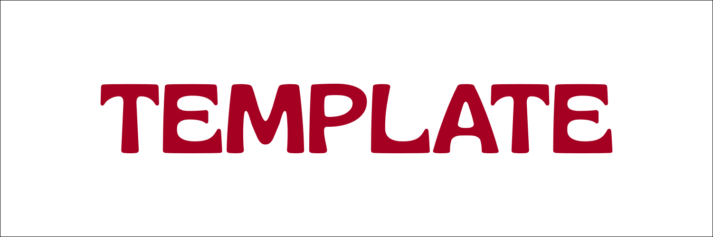

<p align="center">
  <a href="https://github.com/Nexora-Labs-Co/NexoraSuite">
    
  </a>
</p>

<p align="center">
  <h1 align="center">Nexora Suite</h1>
  <p align="center"><strong>Centro de control y gestor de aplicaciones del ecosistema Nexora (Windows y Linux)</strong></p>
  <p align="center">Instala, abre y mantiene actualizadas automáticamente las aplicaciones de Nexora, incluyendo Harmony y otras herramientas.</p>
</p>

<p align="center">
  
  
  
  
  
</p>

---

## Tabla de Contenidos

- [Estado del proyecto](#estado-del-proyecto)
- [Acerca de](#acerca-de)
- [Características principales](#características-principales)
- [Tecnologías y Stack](#tecnologías-y-stack)
- [Requisitos previos](#requisitos-previos)
- [Instalación y Configuración](#instalación-y-configuración)
- [Uso](#uso)
- [Estructura del proyecto](#estructura-del-proyecto)
- [Hoja de ruta](#hoja-de-ruta)
- [Contribuir](#contribuir)
- [Seguridad](#seguridad)
- [Licencia](#licencia)

---

## Estado del proyecto

> **Estado actual:** Activo / En desarrollo. Versión inicial `1.0.0`.

## Acerca de

**Nexora Suite** es el punto de entrada unificado al ecosistema Nexora. Permite descubrir, instalar, abrir y actualizar automáticamente las aplicaciones de Nexora (incluyendo Harmony y otras herramientas) en **Windows** y **Linux**. En Android, las aplicaciones se distribuyen y actualizan mediante APK, por lo que el launcher se centra exclusivamente en escritorio.

Su diseño es minimalista y monocromático (negro `#090C02`, blanco `#EBF5EE` y grises neutros), con un acento `#A50021` para estados destacados.

## Características principales

- **Gestión de aplicaciones:** Listado de apps instaladas y disponibles para instalar.
- **Actualizaciones automáticas:** Consulta `/releases/latest` de GitHub para detectar nuevas versiones.
- **Instalación por plataforma:** `.deb`/binario en Linux, `.exe`/`.msi` en Windows.
- **Interfaz de escritorio:** Ventana con bordes redondeados (rectangulares al maximizar), header personalizado y controles nativos.
- **Búsqueda y vistas:** Barra de búsqueda, alternador de vista cuadrícula/lista.
- **Núcleo nativo opcional:** Rust (`nexora_core`) expuesto vía FFI para comparación de versiones y detección de instalación.

## Tecnologías y Stack

- **Flutter** (desktop: Windows y Linux)
- **Dart**
- **Rust** (`rust/nexora_core`, cdylib) integrado mediante `dart:ffi`
- **GitHub Releases API** para detección de actualizaciones
- **window_manager** para controles de ventana personalizados

## Requisitos previos

Antes de comenzar, asegúrate de contar con lo siguiente en tu entorno de desarrollo:

- **Flutter SDK** (canal estable, compatible con `^3.13.7`)
- **Dart SDK** (incluido con Flutter)
- **Rust / Cargo** (opcional, para compilar `nexora_core`)
- **Linux:** `dpkg`, `pkexec` (para instalación de `.deb`)
- **Windows:** herramientas de instalación nativas (`msiexec`)

## Instalación y Configuración

Clona este repositorio y configura el entorno inicial:

```bash
# 1. Clona el repositorio
git clone https://github.com/Nexora-Labs-Co/NexoraSuite.git
cd NexoraSuite

# 2. Instala las dependencias de Flutter
flutter pub get

# 3. (Opcional) Compila el núcleo Rust
cd rust/nexora_core
cargo build --release
cd ../..
```

## Uso

Ejecuta la aplicación en modo desarrollo:

```bash
# Linux
flutter run -d linux

# Windows
flutter run -d windows
```

Compila para producción:

```bash
flutter build linux
# o
flutter build windows
```

Si compilaste el núcleo Rust, copia la biblioteca resultante junto al binario de la aplicación:

- Linux: `rust/nexora_core/target/release/libnexora_core.so`
- Windows: `rust/nexora_core/target/release/nexora_core.dll`

## Estructura del proyecto

```text
./
├── lib/
│   ├── main.dart
│   ├── app.dart
│   ├── core/
│   │   ├── theme/app_theme.dart
│   │   ├── models/nexora_app.dart
│   │   ├── services/
│   │   │   ├── github_service.dart
│   │   │   ├── app_catalog_service.dart
│   │   │   └── installer_service.dart
│   │   └── ffi/nexora_core.dart
│   └── features/home/
│       ├── home_screen.dart
│       └── widgets/
├── rust/nexora_core/         # cdylib Rust
├── assets/fonts/             # Tipografía Gliker
├── assets/Template-Github.svg
├── CONTRIBUTING.md
├── SECURITY.md
├── CHANGELOG.md
├── LICENSE
└── README.md
```

## Hoja de ruta

- [x] Estructura inicial del proyecto (Flutter + Rust/FFI).
- [x] Pantalla principal con tarjetas en cuadrícula/lista.
- [x] Integración con GitHub Releases para detección de actualizaciones.
- [x] Instalación por plataforma (Linux/Windows).
- [ ] Configuración avanzada (token de GitHub, rutas de instalación).
- [ ] Pruebas automatizadas y CI/CD.

## Contribuir

Las contribuciones son bienvenidas. Por favor, lee [CONTRIBUTING.md](CONTRIBUTING.md) para conocer el flujo de trabajo, estándares de código y checklist de Pull Request.

## Seguridad

Si descubres una vulnerabilidad, consulta [SECURITY.md](SECURITY.md) para reportarla de forma responsable a través del canal privado de GitHub.

## Licencia

Este proyecto se distribuye bajo los términos de la licencia **PolyForm Noncommercial 1.0.0** (consulta [LICENSE](LICENSE) para más detalles, SPDX: `PolyForm-Noncommercial-1.0.0`).

> **Nota de marca:** _Nexora_ es titular de todos los derechos de marca. El nombre, la identidad visual y los logotipos de Nexora no pueden ser utilizados ni redistribuidos sin autorización previa por escrito.

---

<p align="center">
  Un proyecto desarrollado por el equipo de <strong>Nexora</strong>.
</p>
